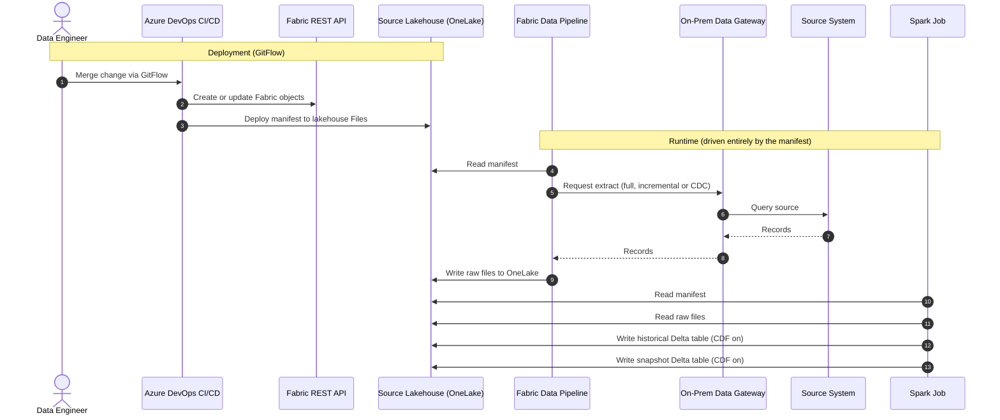
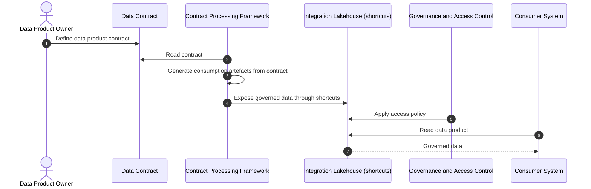
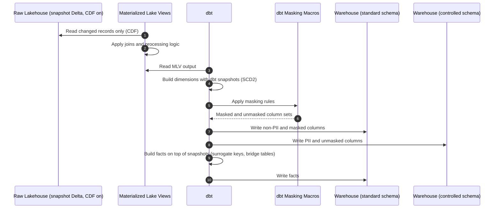
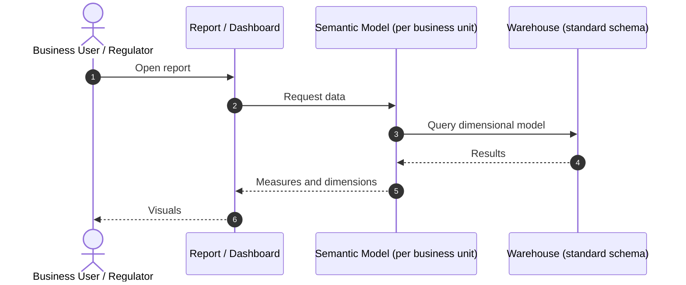
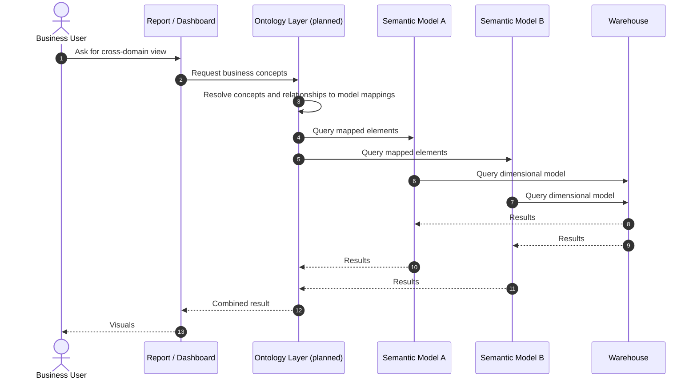
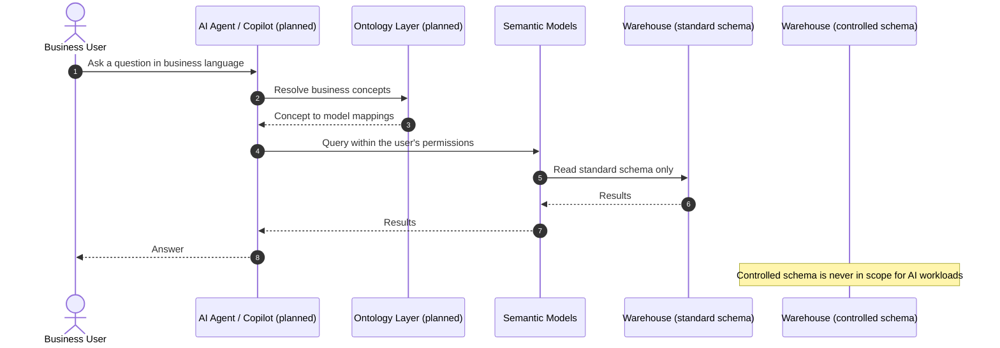
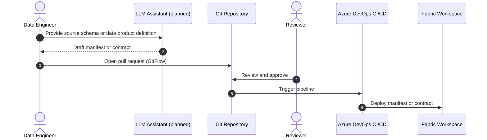

# Architecture Blueprint: Governed, Metadata-Driven Data Platform on Microsoft Fabric

## 1. Purpose and scope

This document describes the high-level design of a layered data platform built on Microsoft Fabric. It focuses on solution design: governance, data modelling, reporting and analytics, the planned semantic (ontology) layer and AI readiness. It does not cover pipeline implementation.

## 2. Design principles

- **Metadata-driven:** behaviour is defined by configuration (manifests and contracts), not code, so frameworks are source-agnostic and reusable.
- **Governance by design:** lineage, access control and PII masking are built into the architecture instead of being added afterwards.
- **Separation of concerns:** each layer has one purpose, a defined audience and its own access model.
- **Everything as code:** GitFlow and CI/CD (Azure DevOps) for both logic and Fabric objects.
- **AI-ready by design:** AI workloads consume data through the same governed path as any other consumer, with PII segregation and lineage already in place.

## 3. Architecture overview

Sources (SQL Server, Oracle, SaaS) feed the **Raw** layer. Raw feeds the **Modelling** layer, which feeds the **Semantic / Reporting** layer. The **Integration** layer publishes governed data products back to internal systems.

| Layer | Purpose | Audience |
|---|---|---|
| Raw | Metadata-driven ingestion, full history and snapshots | Data Engineering only |
| Integration | Data products and contracts for internal systems | Internal systems and integration teams |
| Modelling | Dimensional models (star schemas), PII segregation | Analytics and BI engineers |
| Semantic / Reporting | Semantic models, reports, planned ontology layer | Business users, regulators |

---

## 4. Raw layer: metadata-driven ingestion

### Description

- Ingestion uses On-Premises Data Gateways, Fabric Data Pipelines and Spark jobs.
- Each source has a **manifest** that defines what is ingested, from where and to where, the load pattern (full, incremental or CDC), and the columns used for ingestion and processing.
- The manifest is stored in the file system of the source's own lakehouse in OneLake. All pipelines and Spark jobs read it at runtime, so the same framework serves any source and any data.
- Each source has a dedicated lakehouse with two kinds of Delta tables: **historical** (how each record evolves over time) and **snapshot** (a mirror of the source at a point in time). Change Data Feed (CDF) is enabled.
- The CI/CD pipeline creates the Fabric objects through the Fabric REST APIs and deploys the manifest in the same release.
- Only Data Engineering has access. No business rules are applied here.

### Sequence diagram

---

## 5. Integration layer: data products and contracts

### Description

- Fabric moves from data consumer to **data producer**, following a Data Mesh approach with governed data products.
- Each data product is described by a **data contract**: a declarative definition of what is exposed and under which conditions. Consumption artefacts are generated from the contract, following the same metadata-driven approach as ingestion. Onboarding a new consumer is therefore a configuration change rather than a development effort.
- Data is exposed through **shortcuts** in dedicated lakehouses. Access is granted according to the governance definitions.

### Sequence diagram

---

## 6. Modelling layer: dimensional models

### Description

- Each business area (CRM, Finance, Operational, etc.) has its own **star schema**. The schemas are designed to reference each other.
- Dimensions are **SCD Type 2** to keep the history of changes. Facts hold the business events and reference dimensions through **surrogate keys**. **Bridge tables** expand relationships between dimensions (for example, how one Salesforce party relates to another).
- **PII handling:** each model has two schemas.
  - `standard`: non-PII columns plus masked versions of sensitive ones (for example, hiding the names of vulnerable individuals or people with political ties).
  - `controlled`: PII values and the unmasked originals.
  - As an illustration, of 100 columns, about 90 go to `standard` (5 of them masked) and about 10 go to `controlled` (the 5 unmasked originals plus 5 PII columns).
- **Build approach:**
  - **Materialized Lake Views (MLVs)** in Fabric apply joins and processing logic. Thanks to CDF on the raw snapshot tables, only the latest changes are processed.
  - **dbt** reads from the lakehouse (MLVs) and writes to the Warehouse (`standard` and `controlled` schemas). Dimensions are built with **dbt snapshots**. Facts are queries on top of those snapshots.
- **Governance outcomes:** clear lineage (MLVs), well-defined access control (dbt configuration) and consistent masking (reusable dbt macros).

### Sequence diagram

---

## 7. Semantic model and reporting layer

### Description

- This is the last layer. It is where reports for regulatory bodies and internal use are produced.
- Each **semantic model** is built on top of the dimensional models of one business unit.

### Planned evolution: ontologies

Ontologies are not implemented yet. The goal is to add an ontology layer on top of the semantic models:

- Define shared business concepts (for example customer, party, account) and the relationships between them once.
- Map each concept to the corresponding tables, columns and measures in each semantic model.
- Enable **queries that span several semantic models**, so people can build reports and dashboards quickly without needing to know which model holds which data.
- Reuse the same governance principles: access control and PII rules from the Modelling layer continue to apply.

### Sequence diagram: current state

### Sequence diagram: target state with ontologies (planned)

---

## 8. AI readiness and roadmap

AI is treated as another consumer of the governed platform, not as a separate stack. The foundations below are part of the architecture. The AI capabilities built on top are the **target state** and are presented as roadmap.

**Current state:** Copilot is available to users as an application. There are no AI agents or AI integrations in the platform yet, so apart from the governance foundations described below, everything in this section is roadmap.

### 8.1 Governed AI consumption

**Foundation already in the design**

- PII is segregated by design into `standard` and `controlled` schemas, so AI workloads can be scoped to `standard` only. Unmasked and PII values are never in their reach.
- Lineage from Materialized Lake Views and dbt makes it possible to trace which data feeds any AI-generated answer.
- Access control is defined once (dbt configuration, workspace and lakehouse permissions) and applies equally to people, reports and AI agents.

**Target state (roadmap)**

- Natural-language access to the semantic models, using an AI agent or Copilot that respects the permissions of the user asking.
- The planned **ontology layer** acts as the grounding context for the agent. Shared business concepts and their mappings to each semantic model let the agent resolve a question in business language and answer across several models, instead of guessing which table or measure is meant.

### 8.2 AI-assisted authoring of manifests and contracts (complementary, roadmap)

Because ingestion and data products are metadata-driven, an LLM can draft the configuration and a human reviews it. The change goes through the normal GitFlow pull request process, so it is reviewed, versioned and auditable like any other change.

---

## 9. Cross-cutting concerns

- **CI/CD:** GitFlow with Azure DevOps pipelines for Fabric objects, logic and configuration (manifests).
- **Governance:** lineage through MLVs, access control through dbt configuration and workspace and lakehouse permissions, PII segregation through the standard and controlled schemas, and data contracts for external consumption.
- **Reusability:** one framework per concern, configured per source or contract rather than rebuilt.
