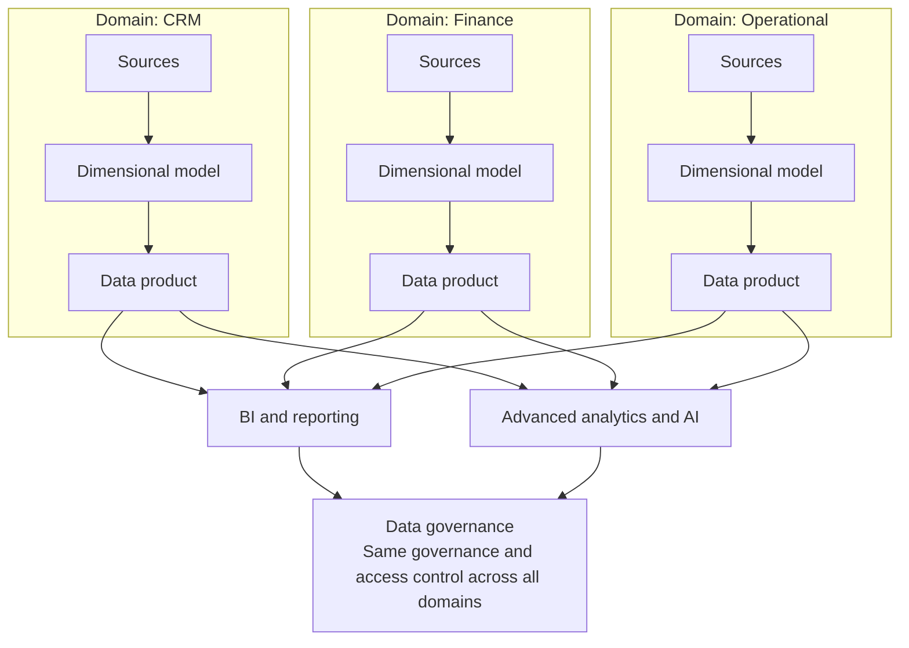
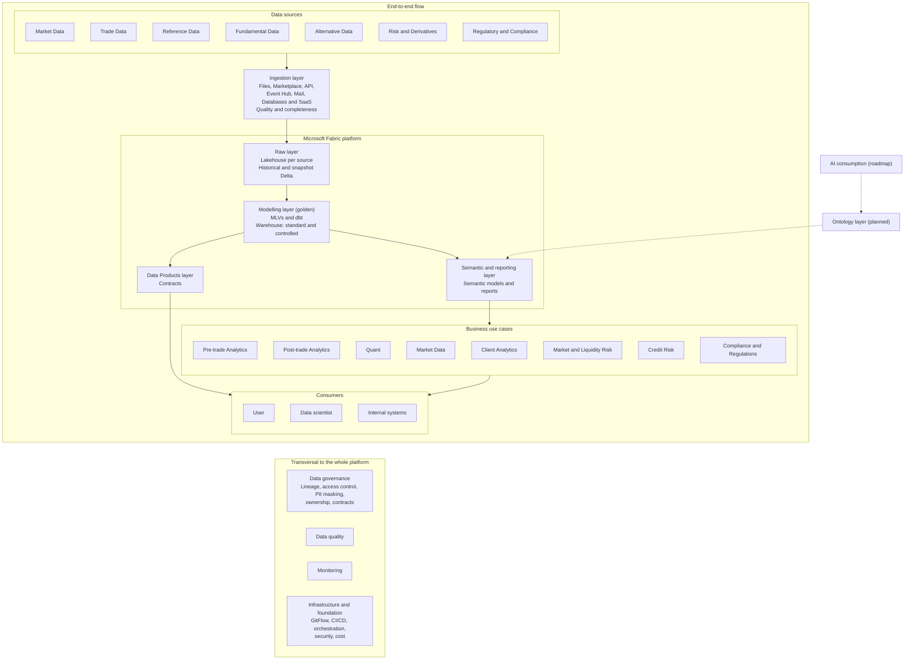
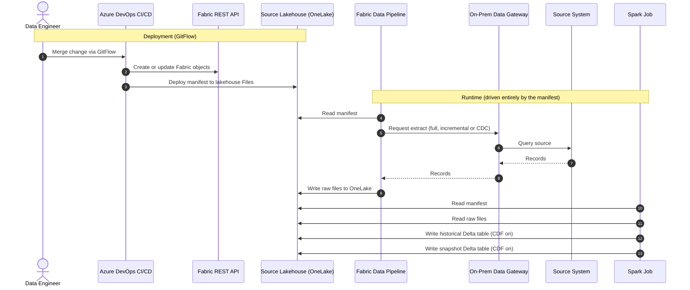
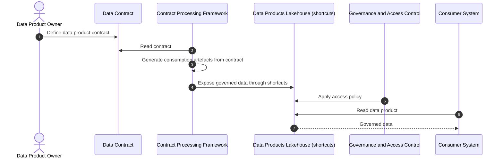
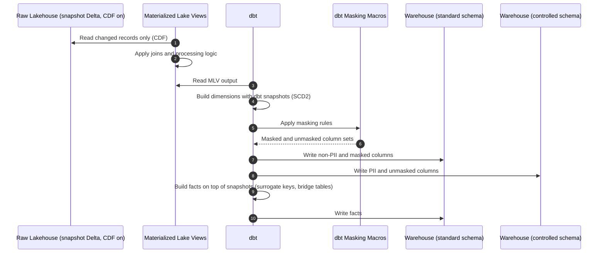
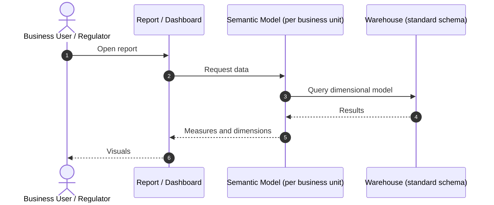
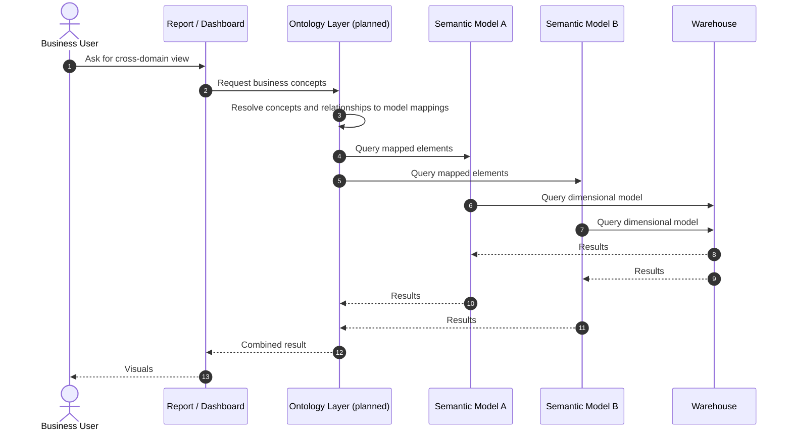
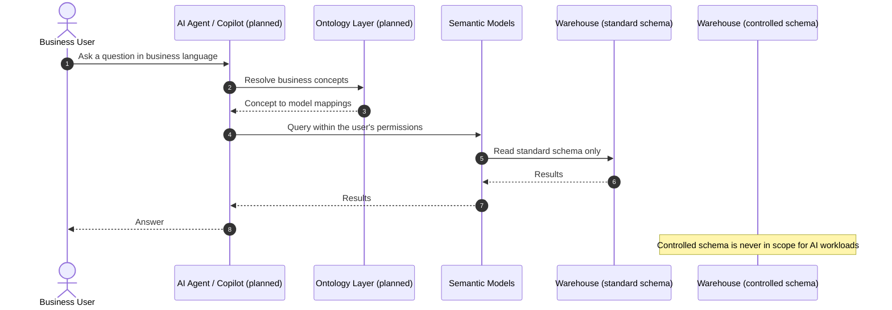
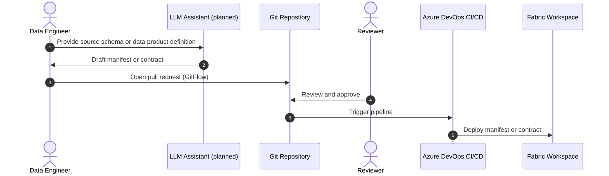
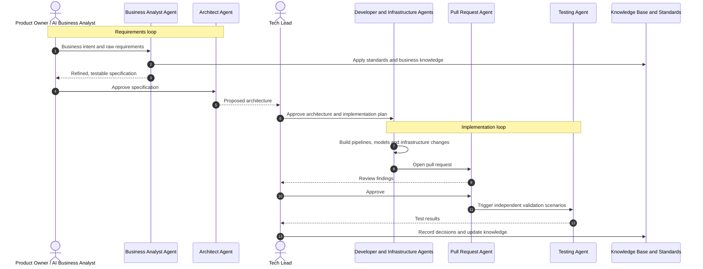

# Architecture Blueprint: Governed, Metadata-Driven Data Platform on Microsoft Fabric

## Overview

This document presents the architecture of a data platform built on Microsoft Fabric for a capital markets context. It is described at the level of strategy and solution design rather than implementation, and it covers data governance, data modelling, reporting and analytics, and AI.

### Context and design drivers

- Data comes from heterogeneous sources and channels (databases, SaaS, files, APIs, event streams, marketplaces), some of them on-premises.
- The main source domains are Market Data, Trade Data, Reference Data, Fundamental Data, Alternative Data, Risk & Derivatives, and Regulatory & Compliance.
- The data includes PII, and reporting serves both regulatory bodies and internal users.
- Several business areas (such as CRM, Finance and Operational) need their own models, and those models must still reference each other.
- Business use cases, from pre-trade analytics to compliance, are served to users, data scientists and internal systems from the same governed data.
- Logic, objects and configuration have to be deployed repeatably, as code.

---

## 1. Data Strategy

### 1.1 Vision

A governed, self-serve data platform on Microsoft Fabric that delivers trusted, reusable data products to the business and is ready for AI.

### 1.2 Strategic objectives

1. Ingest any source through one metadata-driven framework, so onboarding a new source is a configuration change, not a development project.
2. Deliver trusted data products: dimensional models per business area and contract-based data products for internal systems.
3. Govern by design: PII segregation, lineage, data quality and access control built into the platform instead of added afterwards.
4. Serve the main capital markets use cases to users, data scientists and internal systems from one governed golden layer.
5. Simplify consumption: semantic models today, a cross-model ontology layer next, which is also the foundation for AI.
6. Accelerate delivery of data products through an AI-assisted software development lifecycle, with humans supervising every gate.

### 1.3 Strategic pillars (Data Mesh)

| Pillar | What it means here |
|---|---|
| **Data Products** | Owned, trusted and reusable data assets: dimensional models per business area and contract-based products for internal systems. |
| **Data Fabric** | Standardised, repeatable delivery: metadata-driven frameworks, CI/CD and everything as code (GitFlow, Azure DevOps). |
| **Data Governance** | The backbone: PII segregation, lineage, data quality, access control and data contracts, applied the same way across all domains. |

*Each domain owns its data products. The technology and the governance are the same across domains.*

### 1.4 Operating model

Federated. A central platform team owns the ingestion and Raw layers, the frameworks and CI/CD. Business areas own their dimensional models and semantic models, and models are designed to reference each other across areas.

### 1.5 Capability map

| Capability | What it delivers | Layer | Status |
|---|---|---|---|
| Data Integration | Metadata-driven ingestion framework over files, APIs, event streams, marketplaces, mail, databases and SaaS | Ingestion | In place |
| Data Storage | Lakehouse per source, dimensional Warehouse | Raw, Modelling | In place |
| Data Governance | PII segregation, lineage, data quality, access control, contracts | All layers | In place |
| Data Services | Data products, semantic models, ontologies | Data Products, Semantic | Partly in place, ontologies planned |
| Analytics | Reporting and business use cases today, AI later | Semantic / Use cases | Reporting in place, AI on the roadmap |
| Data Foundation | GitFlow, CI/CD, orchestration, monitoring, deployment through Fabric APIs | All layers | In place |

### 1.6 Success measures

Measures that show whether the strategy is working:

- Time to onboard a new source.
- Share of data products with a named owner and a contract.
- PII incidents.
- Report adoption.
- Lead time to deliver a new data product.

### 1.7 Evolution

| Horizon | Focus |
|---|---|
| **In place** | Metadata-driven ingestion and Raw framework, dimensional Modelling layer with PII segregation, semantic models and reporting, CI/CD with GitFlow. |
| **Next** | Wider rollout of data products and contracts in the Data Products layer. Ontology layer on top of the semantic models. AI-assisted delivery of data products. |
| **Later** | Natural-language access ("talk to your data") grounded on the ontology layer. AI-assisted authoring of manifests and contracts. |

---

## 2. Logical architecture

Design principles that apply to every layer:

- **Metadata-driven:** behaviour is defined by configuration (manifests and contracts), not code, so frameworks are source-agnostic and reusable.
- **Governance by design:** lineage, data quality, access control and PII masking are part of the architecture.
- **Separation of concerns:** each layer has one purpose, a defined audience and its own access model.
- **Everything as code:** GitFlow and CI/CD (Azure DevOps) for logic, Fabric objects and configuration.
- **AI-ready by design:** AI workloads consume data through the same governed path as any other consumer.

---

## 3. Key design decisions

| Decision | Rationale |
|---|---|
| A dedicated ingestion layer between the sources and Raw | Channels (files, APIs, event streams, marketplaces, mail, databases) are handled in one place, with quality and completeness checks at the door, so Raw stays a clean, source-shaped store. |
| One manifest per source, stored in the source's own lakehouse in OneLake | Pipelines and Spark jobs become fully parameterisable and agnostic of the source and of the data. A new source is a configuration change. |
| Historical and snapshot Delta tables per source, with Change Data Feed on | Keeps how each record evolved over time and a mirror of the source at each point in time, and lets downstream layers process only the latest changes. |
| Raw restricted to Data Engineering, with no business rules | The business never depends on raw objects. Business rules are defined and applied in later layers. |
| Objects and manifest deployed in the same release (GitFlow, Azure DevOps, Fabric APIs) | Logic, Fabric objects and configuration are versioned and promoted together. |
| A star schema per business area, with cross-area references, SCD Type 2 dimensions, surrogate keys and bridge tables | Preserves history and keeps relationships between dimensions correct, including relationships between entities of the same type. |
| `standard` and `controlled` schemas in every model | Segregates PII: non-PII and masked values are exposed in `standard`, while PII and unmasked values stay in `controlled`. |
| Materialized Lake Views and dbt | MLVs process only the latest records thanks to Change Data Feed and give clear lineage. dbt defines where data is read and written, access control through configuration, and masking through macros. |
| Data contracts and shortcuts for data products | Fabric acts as a data producer. Integration is agile, contract processing follows the same metadata-driven approach as ingestion, and access follows the governance definitions. |
| Ontology layer on top of the semantic models (planned) | Enables queries across several semantic models so people can build reports and dashboards quickly, and gives AI a business-level grounding layer. |
| AI-assisted software development lifecycle with human gates | Autonomous agents handle routine delivery work end to end while people direct, review and approve at every gate, which shortens lead time without weakening governance. |

---

## 4. Layer design

### 4.1 Data sources

**Purpose.** Identify the source domains the platform serves and treat each one as a managed source, with its own manifest and lakehouse.

| Source domain | Typical content |
|---|---|
| Market Data | Prices, quotes and other market feeds |
| Trade Data | Orders, executions and positions |
| Reference Data | Instruments, counterparties and other master data |
| Fundamental Data | Company and economic fundamentals |
| Alternative Data | Non-traditional and third-party datasets |
| Risk & Derivatives | Risk measures and derivative trade data |
| Regulatory & Compliance | Regulatory and compliance records |

### 4.2 Ingestion layer (Data Integration)

**Purpose.** Bring any source into the platform through one reusable, metadata-driven framework, and check quality and completeness on the way in.

**Typical patterns**

- Channels: files, marketplaces, APIs, event streams (Event Hub), mail, and databases and SaaS through On-Premises Data Gateways.
- Metadata-driven ingestion: one manifest per source defines what is ingested, from where and to where, the load pattern (full, incremental or CDC) and the columns used for ingestion and processing.
- Fabric Data Pipelines and Spark jobs read the manifest, so they are source-agnostic.
- Quality and completeness checks are applied at ingestion, before data reaches Raw.
- CI/CD creates the Fabric objects through the Fabric APIs and deploys the manifest in the same release.

**Key non-functional requirements**

- Reusability: the same framework serves any source and any data.
- Completeness: ingested data is reconciled against what the source delivered.
- Repeatability: all objects and configuration deployed as code.

**Success measures.** Time to onboard a new source; share of sources running on the framework.

**Key capabilities.** Batch, incremental, CDC and event-based ingestion; manifest management; quality and completeness checks; automated deployment.

### 4.3 Raw layer (Data Storage)

**Purpose.** Keep full history and point-in-time snapshots of every source, without applying business rules. Only Data Engineering has access.

**Typical patterns**

- One lakehouse per source, with the source's manifest stored in the lakehouse file system in OneLake.
- Delta tables of two kinds: historical (how each record evolves) and snapshot (a mirror of the source at a point in time), with Change Data Feed enabled.
- Raw files land in OneLake and Spark processing writes the Delta tables, both driven by the manifest.

**Key non-functional requirements**

- Traceability: full history of record changes.
- Security: access restricted to Data Engineering.
- Reusability: the same storage pattern for every source.

**Success measures.** Share of sources with historical and snapshot tables; time to reprocess a source.

**Key capabilities.** Historical and snapshot storage; Change Data Feed; restricted access.

### 4.4 Modelling layer, the golden layer (Data Storage, Data Governance)

**Purpose.** Turn raw history into trusted, reusable dimensional models per business area, with PII segregated by design.

**Typical patterns**

- A star schema per business area (for example CRM, Finance, Operational), designed to reference each other.
- SCD Type 2 dimensions to keep history; facts that reference dimensions through surrogate keys; bridge tables to expand relationships between dimensions.
- Two schemas per model. `standard` holds non-PII columns plus masked versions of sensitive attributes. `controlled` holds the PII values and the unmasked originals. As an illustration, of 100 columns about 90 go to `standard` (5 of them masked) and about 10 go to `controlled` (the 5 unmasked originals plus 5 PII columns).
- Materialized Lake Views apply joins and processing logic and, thanks to Change Data Feed on the raw snapshots, process only the latest changes. dbt reads from the lakehouse and writes to the Warehouse. Dimensions are built with dbt snapshots, and facts are queries on top of those snapshots.

**Key non-functional requirements**

- Privacy by design: PII segregation and reusable masking macros.
- Lineage: clear end-to-end data lineage through the Materialized Lake Views.
- Access control: defined once through dbt configuration.
- Efficiency: incremental processing of changed records only.

**Success measures.** PII incidents; reuse of conformed dimensions across business areas.

**Key capabilities.** Dimensional modelling; history tracking (SCD2); PII segregation and masking; lineage.

### 4.5 Semantic model and reporting layer (Data Services, Analytics)

**Purpose.** Deliver consistent metrics and reports for regulatory and internal use, and evolve towards cross-model discovery through ontologies.

**Typical patterns**

- One semantic model per business unit, built on that unit's dimensional model.
- Planned ontology layer: shared business concepts and their relationships defined once and mapped to the tables, columns and measures of each semantic model, enabling queries that span several semantic models so people can build reports and dashboards quickly.

**Key non-functional requirements**

- Consistency: shared definitions through semantic models.
- Governed access: access and PII rules from the Modelling layer continue to apply.
- Self-service: faster report building across domains once the ontology layer exists.

**Success measures.** Report adoption; time to build a cross-domain report (once ontologies are in place).

**Key capabilities.** Semantic models; regulatory and internal reporting; ontology layer (planned).

### 4.6 Data Products layer (Data Services)

**Purpose.** Expose governed data products to internal systems through data contracts. Fabric moves from data consumer to data producer.

**Typical patterns**

- Data Mesh data products, each described by a data contract that defines what is exposed and under which conditions.
- Contract-driven generation of consumption artefacts, following the same metadata-driven approach as ingestion.
- Access through shortcuts in dedicated lakehouses, granted according to the governance definitions.

**Key non-functional requirements**

- Interface stability: the contract is the agreement between producer and consumer.
- Security: access follows the governance definitions.
- Agility: onboarding a new consumer is a configuration change.

**Success measures.** Share of data products with a named owner and a contract; time to onboard a new consumer.

**Key capabilities.** Data contracts; contract processing framework; governed access through shortcuts.

### 4.7 Business use cases and consumers (Analytics)

**Purpose.** Turn the golden layer into value for the business through the most common capital markets use cases, each served to the right consumer.

| Group | Use cases |
|---|---|
| Trading analytics | Pre-trade Analytics, Post-trade Analytics |
| Quantitative and market | Quant, Market Data |
| Client | Client Analytics |
| Risk, compliance and regulation | Market & Liquidity Risk, Credit Risk, Compliance & Regulations |

| Consumer | How it consumes |
|---|---|
| User | Reports and dashboards on the semantic models. |
| Data scientist | Governed access to the `standard` data, with `controlled` out of reach. |
| Internal systems | Data products exposed through contracts. |

All consumers use the same governed path, so access and PII rules apply equally to every one of them.

### 4.8 AI: delivery and consumption (Analytics)

AI is treated as another part of the governed platform, not as a separate stack. It appears in two ways: in how data products are delivered, and in how data is consumed.

**Current state.** Copilot is available to users as an application. There are no AI agents or AI integrations in the platform yet, so apart from the governance foundations below, everything in this section is roadmap.

**Foundation already in the design**

- PII is segregated into `standard` and `controlled` schemas, so AI workloads can be scoped to `standard` only. Unmasked and PII values are never in their reach.
- Lineage from Materialized Lake Views and dbt makes it possible to trace which data feeds any AI-generated answer.
- Access control is defined once and applies equally to people, reports and AI agents.

#### AI SDLC: accelerating delivery with supervised autonomous agents

The target delivery model uses specialised AI agents to run the software lifecycle of a data product end to end, while people direct, review and approve at every gate.

- **Business intent becomes working software in four steps.** Requirements are captured as precise, testable specifications, pass through architecture governance, are built autonomously by agents, and are then validated against independent scenarios.
- **Two loops.** A requirements loop (raw requirements to refined requirements, architecture and reviewed specification) and an implementation loop (implementation plan, infrastructure changes, code, pull request review and testing).
- **Agents do the routine work.** Business analysis, architecture drafting, coding, code review, test generation, data pipeline construction and technical writing are handled by specialised agents working in parallel.
- **Humans stay in control.** Product owner, business analyst, tech lead, engineers and testers direct the agents and approve their outputs at each gate.
- **Knowledge compounds.** Corporate standards, coding standards and the business knowledge base are shared with every agent, with ontology-driven retrieval, so decisions and patterns are not lost between sprints or team members.
- **Governance and audit are built in.** Every specification decision, code change, validation result and agent action is recorded, and approval workflows and cost tracking are enforced at platform level.
- **The builder never sees the exam.** Validation scenarios are written independently during specification and kept separate from the agents that build, so the build is not tuned to pass the test instead of meeting the requirement.
- **Outcome.** Requirements in hours, cycle time in hours to days, and lead time in days to weeks (see Appendix A.8).

#### Business use case: talk to your data (roadmap)

Natural-language access to the semantic models through an AI agent or Copilot that respects the permissions of the user asking. The ontology layer acts as the grounding context, so the agent can resolve a question in business language and answer across several models (see Appendix A.6).

#### AI-assisted authoring of manifests and contracts (roadmap)

An LLM drafts the configuration, and a person reviews it through the normal GitFlow pull request process, so it stays reviewed, versioned and auditable (see Appendix A.7).

---

## 5. Cross-cutting concerns

The following apply to the whole platform and sit across every layer.

- **Data governance:** lineage through Materialized Lake Views, access control through dbt configuration and workspace and lakehouse permissions, PII segregation and masking through the standard and controlled schemas, ownership, and data contracts for consumption by other systems.
- **Data quality:** quality and completeness checks at ingestion and in the models.
- **Monitoring and infrastructure (Data Foundation):** pipeline orchestration, auditing and logging, monitoring, security and cost management.
- **CI/CD:** GitFlow with Azure DevOps pipelines for Fabric objects, logic and configuration (manifests).
- **Reusability:** one framework per concern, configured per source or contract rather than rebuilt.

---

## Appendix A. Detailed sequence diagrams

### A.1 Ingestion and Raw layers: deployment and runtime

### A.2 Data Products layer: data products and contracts

### A.3 Modelling layer: dimensional models

### A.4 Semantic and reporting layer: current state

### A.5 Semantic and reporting layer: target state with ontologies (planned)

### A.6 Talk to your data: governed AI consumption (roadmap)

### A.7 AI-assisted authoring of manifests and contracts (roadmap)

### A.8 AI SDLC: supervised autonomous delivery of a data product (target)

